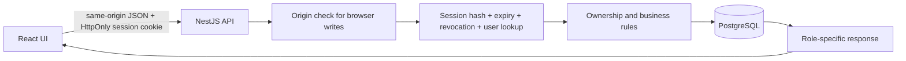
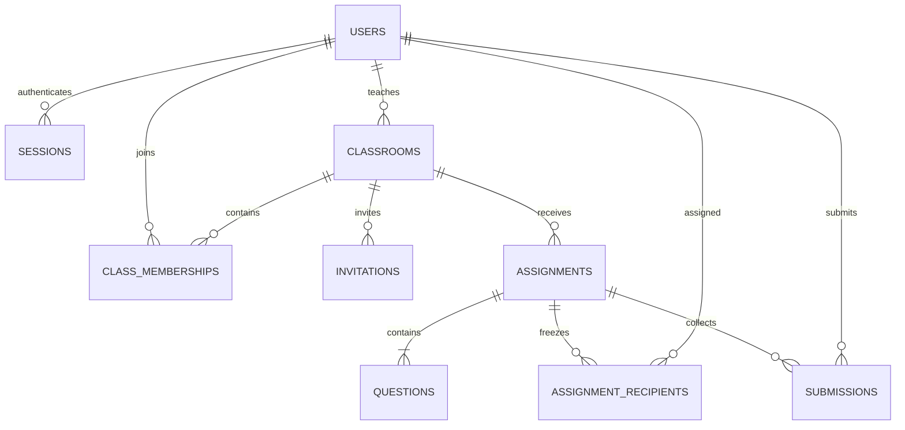

# Architecture and decisions

## Request path





## Session and account model

The browser uses a same-origin HttpOnly cookie backed by a database session. Random 256-bit tokens are stored only as SHA-256 hashes. Sessions have a fixed seven-day lifetime. Every authenticated request checks expiry and revocation. Logout revokes the current token; changing a password locks the user row and revokes all sessions. Login locks that same row while checking the password and creating the session, preventing a concurrent password change from leaving a session authenticated with the old password. Requests already authorized before revocation may finish; subsequent requests fail.

Login/registration also return the opaque token for API clients. Browser code uses the cookie and does not persist the token in local/session storage. Production cookies are Secure and SameSite=Lax. Unsafe requests with an unexpected Origin or cross-site Fetch Metadata are rejected. Cookie-authenticated writes need the exact configured Origin. Non-browser clients may authenticate with Bearer and omit Origin. Public registration requires an invitation and cannot select a role.

Teacher invitations are created by an operator CLI, bound to an email, expire after 48 hours, and allow one registration. Teachers create class invitations with 1–100 uses and a 1–168-hour lifetime. Invitation consumption and new account/membership creation share a transaction. Invite tokens are shown only on creation, never in list endpoints or URL query parameters. Duplicate registration rolls back consumption. Joining an existing membership does not consume another use of an otherwise valid invitation.

## Membership and publication

Publication takes the classroom row lock, then the assignment row lock, and copies current members into `assignment_recipients`. Joining/removing members and consuming/revoking class invitations also take the classroom lock first. This serializes publication against membership changes and avoids ambiguous assignment audiences.

Removing a student marks their existing recipients as removed and deletes the current membership, in the same transaction. Reports retain the snapshot and any score. Rejoining creates a membership but leaves past recipient records revoked. Future publications include the rejoined student.

Submission takes a shared lock on the active recipient record. Removal updates that record and waits for an in-flight accepted submission to finish. If removal wins first, the submission sees the removed record and is rejected. No new submission can become authorized after removal commits.

## Drafts and submissions

Draft editing locks the assignment and requires the current integer version. A stale editor receives 409, preventing silent overwrites. Replacing all questions and updating draft metadata occur atomically. A draft keeps its original class. Publishing locks the same assignment; published content cannot be edited/deleted. Deleting a draft removes questions and the assignment in one transaction. The original migration is unchanged; later migrations add sessions, invitations, versions and recipient snapshots.

```mermaid
sequenceDiagram
  participant UI as Student browser
  participant API as API
  participant DB as PostgreSQL
  UI->>API: answers + requestId
  API->>DB: verify session and active recipient
  API->>DB: BEGIN; lock recipient FOR SHARE
  API->>DB: read prior request + immutable questions
  API->>API: canonical hash; validate all answers; grade
  API->>DB: conditional INSERT before database deadline
  Note over DB: Unique assignment/student and student/requestId
  DB-->>API: saved result or uniqueness conflict
  API->>DB: exact replay lookup; COMMIT
  API-->>UI: saved submission ID + score
```

The database clock controls acceptance. Unique `(assignment_id,student_id)` ensures one final attempt; unique `(student_id,request_id)` plus a canonical payload hash distinguish retries from conflicts. Exact retries return the saved result after the deadline, provided access still exists. A request ID reused for another assignment or payload conflicts. A failed transaction leaves no partial submission. Student responses never contain answer keys.

## Reads, pagination and reports

Lists filter by owned class/active recipient before applying optional class, literal case-insensitive title substring and derived status. PUBLISHED means published and not yet due; CLOSED means published and due. Stable sort is `created_at DESC,id DESC`; member/report sort is `name,id`. Count and rows share a repeatable-read transaction. Detail metadata, questions and the student result also share one snapshot; statistics and report audience decisions are made inside their read transaction. This prevents a concurrent edit/publication/enrollment from mixing two versions in one response. Separate pagination requests are not a persistent snapshot; concurrent inserts/deletes can move offsets.

Published report denominators use the frozen recipient count, including removed students. Average percentage includes only submissions; no submissions means null. Reports left-join submissions to show students who have not submitted. Student projections omit correct options even after submission.

Read hooks abort obsolete fetches and key state to the requested resource, so a previous assignment is not displayed during a selection change. Error states expose retry controls. Submission retries preserve a UUID while answers are unchanged; reloading retrieves any already-committed result.

## Migrations and operational boundaries

The runner discovers ordered `NNN_name.sql` files, rejects duplicate sequence numbers, missing/reordered applied history or checksum changes, and applies pending migrations in a single advisory-locked transaction. Migration 003 backfills existing published recipients from current membership plus historical submissions. Historic membership not recorded by the starter cannot be reconstructed beyond those records.

The monolith serves built assets and the API from one origin in production, behind one HTTPS proxy. PostgreSQL is required in production. PGlite remains an isolated local demo/test option and cannot prove multi-connection behavior. The verification record distinguishes both test environments.

Login throttles are process-local; horizontal scaling requires a shared strategy. Account disabling, automated email/password recovery, file uploads, manual grading, queues and distributed services are outside this release. Database foreign keys/constraints enforce stored data shape; application rules such as role assignment, immutable published content and authorization remain enforced through the API rather than permitting arbitrary database writes.

## Canonical identifiers and regression evidence

All HTTP UUID parameters and shared UUID input fields are validated and normalized to lowercase before comparisons or payload hashing. Thus uppercase spelling does not turn the same question, class or request into a different object. The API still requires hyphenated UUID syntax.

Four regression cases first failed on the prior implementation: uppercase draft class IDs returned 400; a preview combined old metadata with newly committed questions; statistics and reports could select a roster after publication using the previous draft status. The fixes use canonical identifiers and repeatable-read transactions. Tests force the concurrent write between metadata and later reads and assert that the write actually happened; they do not merely check an isolation-level string.

References: [PostgreSQL UUID input/output](https://www.postgresql.org/docs/17/datatype-uuid.html) and [transaction isolation](https://www.postgresql.org/docs/17/transaction-iso.html).
